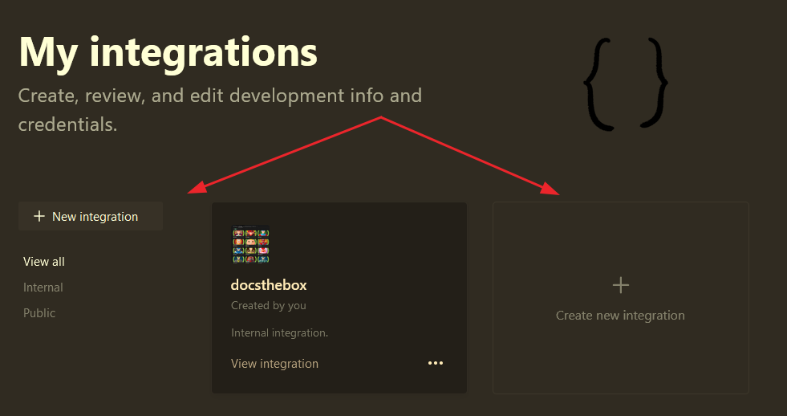
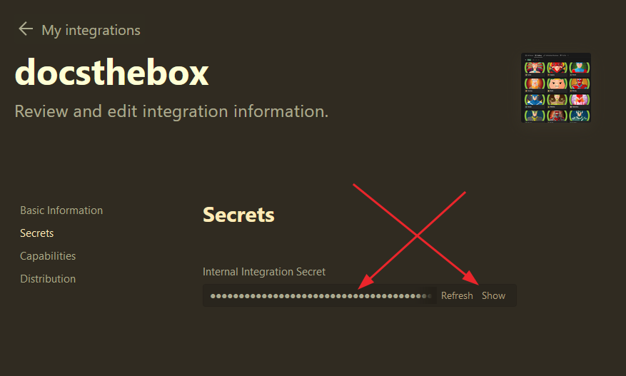
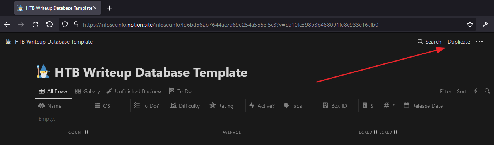
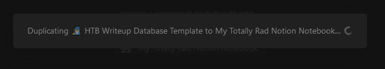
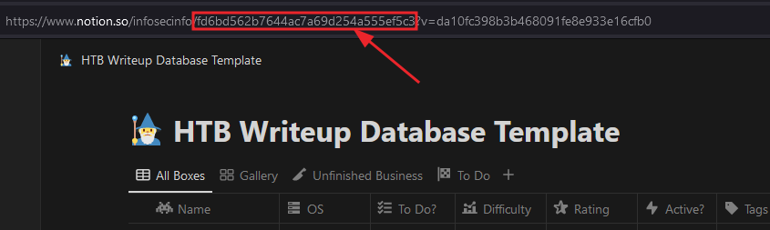
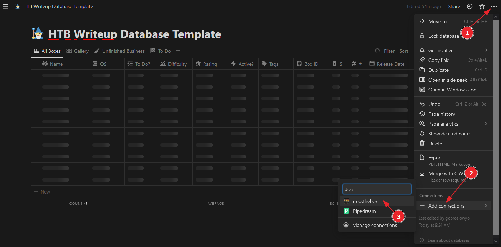
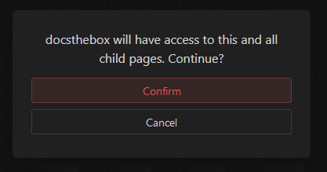
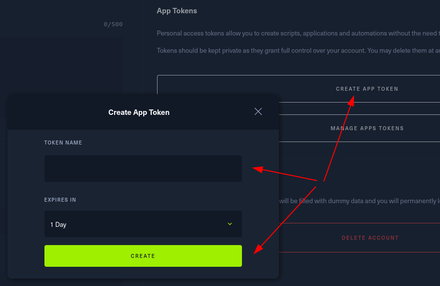

# How To Use

- Create a Notion Developer Integration

  - [Notion Integrations](https://www.notion.so/my-integrations)

  

  - Get a Notion Internal Integration Secret

  

- Duplicate the Notion template

  - [Notion Template](https://infosecinfo.notion.site/fd6bd562b7644ac7a69d254a555ef5c3?v=da10fc398b3b468091fe8e933e16cfb0&pvs=4)

  

  - Choose workspace to duplicate to

  

- Get the Notion DB ID from the URL (yours will be unique from the screenshot)

  

- Authorize the Notion Integration to access your new Notion database

  

  

- Get a Hack The Box app token from your profile settings page

  - [Profile Settings](https://app.hackthebox.com/profile/settings)

  

---

By now you should have three things:

  1. A Notion Internal Integration Secret

  1. The database ID of your Notion DB

  1. Your Hack The Box App Token

If don't have these items please review the above steps again.

- Configure HTB_TOKEN and NOTION_TOKEN as environment variables.
  - `export HTB_TOKEN="YOUR_HTB_TOKEN"`
  - `export NOTION_TOKEN="YOUR_NOTION_TOKEN"`

- Install Poetry (you don't need poetry really, just requests, but poetry makes it easier if the project grows)

  - `pip install --user poetry`

  - `poetry run python box-to-docs.py --help`

  or

  - `pip install --user requests`

  - `python box-to-docs.py --database-id YOUR_DATABASE_ID`

  or

  - `docker run -e HTB_TOKEN -e NOTION_TOKEN -v /tmp:/tmp ghcr.io/goproslowyo/docsthebox:latest --database-id YOUR_DATABASE_ID`

Boxes already in your database are never duplicated or rewritten. If HTB has moved a box's image (which leaves old pages with blank art), the next run points that page's icon and cover at the new image. Icons and covers you set yourself (emoji, uploads, other sites) are left alone.

Add `--dry-run` to see what would be created or repaired without changing anything.

NOTE: Please adjust the paths accordingly if you're on windows.
